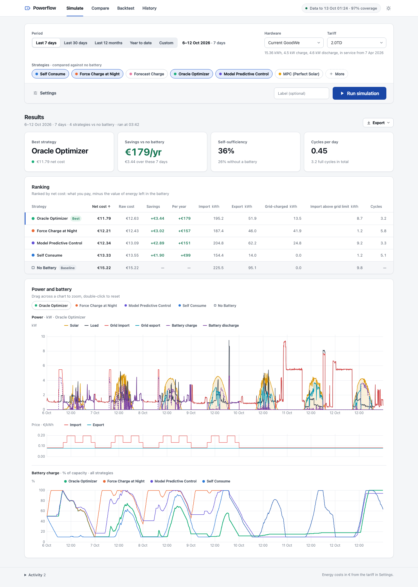
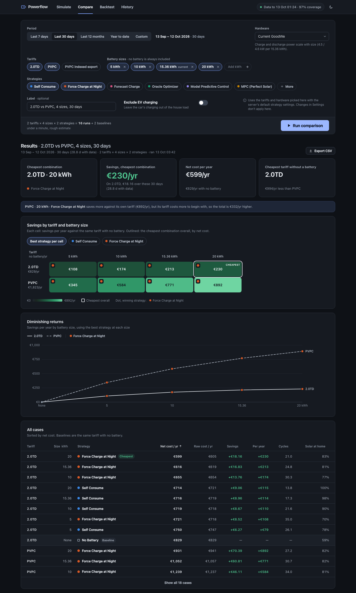

# **Powerflow** energy optimization simulator


## Overview
A Python-based simulator for optimizing solar PV systems with battery storage. The simulator allows testing different
battery management strategies to maximize cost savings and efficiency by analyzing historical generation 
and consumption data.

> [!NOTE]
> Built around one real installation (GoodWe 15.36 kWh LFP, ~5.4 kWp PV, 5.5 kW grid limit, Spanish 2.0TD or PVPC
> prices), but every battery, grid and tariff parameter is editable.

## Why
Which battery strategy, tariff and battery size actually saves the most money, and how close is a simulator to what
the real system did? The simulator replays per-minute solar and house load through a battery model and prices every
minute with the chosen tariff.

## Case study
This project is what made [Panels, a bigger battery, PVPC or a smarter controller?](https://albero.dev/blog/more-solar-panels)
possible. The write-up replays a full year of the house's minute data through the simulator to price every upgrade on
the same footing: switching to PVPC, a better controller, a second battery pack, and 3 or 4 more panels with the
inverter's limits included.

The [interactive explorer](https://albero.dev/attachments/panel-upgrades/index.html) compares 12 panel and battery
setups side by side, from yearly bills under each strategy and tariff down to single minutes.

## Web UI
`make web-dev`, then open http://localhost:5173. Light and dark themes, works on a phone.



- **Simulate**: pick a period, hardware and tariff preset, and strategies. Every run includes a no-battery baseline, so
  the KPI cards and ranking show savings in € for the period and per year. Charts cover power flows, battery charge
  and import price, with drag-to-zoom. Results export as CSV (summary, monthly, per-minute timeseries).
- **Compare**: a scenario matrix of tariffs × battery sizes × strategies. Shows a savings heatmap, a
  diminishing-returns curve per tariff and a sortable table of all cases. The cheapest combination is ranked by net
  cost, not by savings against its own tariff.
- **Backtest**: replays a period with the measured starting charge and compares simulated against measured grid
  import, export, cost and battery charge, day by day. Battery limits switch automatically at the 2026-04-07 hardware
  upgrade. "Compare all core strategies" shows which strategy behaves most like the real controller.
- **History**: every run and comparison is saved (sqlite, `data/runs.db`) and can be reopened, re-run, exported or
  deleted. Per-minute data is kept in memory for the 8 most recent runs.



### Strategies
Core: No Battery (baseline), Self Consume, Force Charge at Night, Forecast Charge, Oracle Optimizer (perfect-foresight
linear program, the lower bound on cost), Model Predictive Control and MPC with perfect solar. More rule-based and MPC
variants sit under "More". The DQN agent is experimental and only available when `output_files/dqn_policy.pt` exists.

### How costs are compared
- Ranking and savings use the **adjusted cost**: the period's cost net of the value of the energy left in the
  battery at the end, so a strategy can't look cheaper by draining the battery.
- Per-year figures scale the run's own hours with data (`× 8760 / valid_hours`), and only appear for runs of at least
  72 hours.
- "Import above grid limit" is informational. The real house regularly imports above 5.5 kW (mostly EV charging at
  night, driven by [ha-ev-charge-optimizer](https://github.com/leandroalbero/ha-ev-charge-optimizer)), and optimising
  strategies legitimately buy cheap valley power for the car.
- Date ranges are inclusive local days (Europe/Madrid).

## Quick Start (Docker)
```bash
git clone https://github.com/leandroalbero/powerflow-simulator.git
cd powerflow-simulator
docker compose up --build
```
Open http://localhost:8000. The image does not contain the dataset. `docker-compose.yml` mounts `./data` at `/app/data`. Fetch it first (see Data).

## Local Development
```bash
# Create virtual environment
python -m venv .venv
source .venv/bin/activate

# Install dependencies
pip install -r requirements.txt

# Install frontend dependencies
cd web/frontend && npm install && cd ../..

# Start backend + frontend dev servers
make web-dev
```
Backend runs on http://localhost:8000, frontend dev server on http://localhost:5173.

Tests and lint:
```bash
python -m pytest -q
python -m ruff check src web/backend tests
cd web/frontend && npx svelte-check && npm run build
```

## Data
Sensor history is not in git. Copy the env template, fill the InfluxDB 1.8 credentials, and fetch:

```bash
cp .env.example .env
make fetch-data
```

`make fetch-data` (`python -m src.data.refresh`) writes one zstd parquet per entity under `data/influx/`:

| file | columns |
|---|---|
| `data/influx/<key>.parquet` | `ts` timestamp[ns, UTC], minute start, unique, strictly increasing; `mean` float64; `count` int32 raw samples in that minute |

Rows exist only for minutes that had at least one sample. `data/influx/manifest.json` records `source`, `updated_at`, and per entity `entity_id`, `measurement`, `first_ts`, `last_ts`, `rows`. Keys: `pv`, `load`, `battery`, `grid`, `soc`, `ev`. Incremental runs re-fetch the last 3 hours. `--full` replaces from 2022-08-25.

Irradiance CSVs in `data/irradiance/` are refreshed in the same command (Open-Meteo). Pass `--no-with-irradiance` to skip them.

The data badge in the web UI shows freshness and coverage, and its Refresh button runs the same incremental fetch
in the background. Without InfluxDB credentials the backend falls back to `data/pv_power_highres.csv` and
`data/house_consumption_highres.csv` if present, or to CSVs uploaded through the API. `POWERFLOW_DATA_DIR` moves
the whole data directory.

## Programmatic Usage
From the repo root:
```python
from src.data.frame import build_power_frame
from src.domain.battery.models import Battery
from src.domain.energy_simulator.models import run
from src.domain.grid.model import Grid
from src.domain.strategy.model import SelfConsumeStrategy
from web.backend.services.data_service import DataService
from web.backend.services.simulation_service import SimulationService

frame = build_power_frame("2026-10-01", "2026-10-07")          # inclusive local days
tariff = SimulationService(DataService())._build_tariff()        # default 2.0TD
battery = Battery(capacity=15.36, max_charge_rate=4.5, max_discharge_rate=4.6)
strategy = SelfConsumeStrategy(battery, Grid(max_import=5.5, max_export=5.5), tariff)

result = run(frame, strategy, tariff)
print(result.metrics["adjusted_cost"], result.metrics["self_consumption_rate"])
```

## Related projects
- [ha-battery-mpc](https://github.com/leandroalbero/ha-battery-mpc): Home Assistant (HACS) integration that runs this
  simulator's Model Predictive Control strategy on the real battery, with Open-Meteo solar forecasts. The Backtest
  page compares it against the simulated strategies.
- [ha-ev-charge-optimizer](https://github.com/leandroalbero/ha-ev-charge-optimizer): Home Assistant (HACS)
  integration that sets the EV charger's power from solar surplus, off-peak rates and grid headroom.

## Future Plans
1. ~~Home Assistant integration that executes the chosen strategy~~ Done:
   [ha-battery-mpc](https://github.com/leandroalbero/ha-battery-mpc) runs the MPC strategy in production.
2. Weather-aware and price-aware strategies trained on the backtest results
3. Better battery model (temperature, ageing, inverter losses)

## Contributing
Contributions are welcome! Please open an issue or submit a pull request for any improvements or bug fixes.
